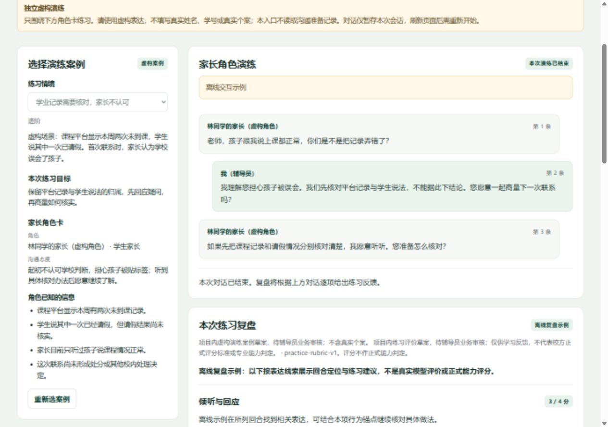

# 多 Agent 第二阶段实施与验收

2026-11-18。本轮对应[多 Agent 实施计划](../product/家校沟通助手_多Agent实施计划_2026-11-18.md)阶段 2：场景模拟与沟通复盘。原有表单和“粘贴或导入记录”继续用于沟通准备，阶段 2 使用独立入口及会话。

## 使用流程

在项目根目录运行 `npm run start:mock`，打开启动时显示的本机地址，确认页头标注离线示例。进入“场景演练与复盘”，选择虚构案例，阅读角色卡、练习目标和评价规则，再开始演练。系统扮演案例中的家长，使用者扮演辅导员。

本轮案例覆盖学业否认、焦急询问和协作沟通。案例与角色已知事实可在 `app/practice-cases.json` 审查；评价项和 1–4 分的行为锚点在 `app/practice-rubric.json` 审查。评价项包括倾听、事实核对、边界、协作和收尾，规则属于项目内虚构练习草案，待业务审核，不代表校方正式标准或专业能力认定。

演练可以多轮进行，每条辅导员消息上限 1000 字，每次演练最多 20 个辅导员回合。用户点击结束后，系统才开放“生成复盘”；结束本身不调用评估，未结束的对话不能提交评分。没有辅导员发言时不能复盘。结束后不能追加发言，可另开一次演练。

复盘按五个评价项分别给出反馈、可替换的表达及下一项练习建议。反馈的引句必须逐字取自本次演练的辅导员回合，通过回合编号可定位原文。缺少适用证据的评价项显示暂无法评价，不据此给分。评分只供练习，不用于正式考核。

## 边界与恢复

本入口只接收预置虚构案例，不把首期记录、分析条目或家长底稿传入演练上下文，也不提供真实沟通记录导入。模型模式下，演练所需角色卡、消息及已结束对话会按相应阶段提交给当前配置的外部模型；离线模式不调用外部模型。

安全机制针对模型生成。练习者的责备、武断诊断、过度保证、风险词或不符合常见步骤的表达，不会触发停止或拒绝复盘；这些表达正是需要引用并分析的问题材料。复盘按实际行为及效果提供反馈，不要求固定话术或顺序，不作人格定论。家长角色可以表达疑虑、追问依据，不认同错误主张或扩展危机情节。

网络失败保留现有页面内容，可重试失败步骤。生成结果校验失败最多自动修复一次，携带前次结果和具体失败字段。家长回复仍不合格时不显示该回复，但保存练习者本轮发言，允许继续或结束后复盘；不因模型失败丢弃练习问题。服务端使用请求编号合并在途重复操作并重放成功结果，版本检查拒绝旧请求，防止重复发言或跨轮混入。复盘失败保留已结束的对话，可单独重试复盘。

模拟输出另外检查角色卡与当前对话之外的阿拉伯数字及完整数字日期；复盘的替代表达与练习建议检查诊断、处置保证和固定时限。此类规则不能证明所有事实语义正确，中文数词、人物、原因及评价与证据是否相符仍需逐例审查。

演练使用独立 `practice_session` 临时 HttpOnly 会话 cookie；服务端只在内存保存最多 30 分钟，刷新页面、超时或服务重启后需重新开始。不会把演练正文保存到浏览器永久存储或个案库。常规日志只记录请求编号、阶段、状态、耗时及调用元数据，不记录演练消息、模型回复或复盘正文。临时会话隔离不等于正式账号体系，校内使用仍须完成原有身份、权限和数据范围确认。

## 本地验收步骤

1. 查看案例目录和角色卡，核对虚构标记、角色已知事实、练习目标、评价规则版本与待业务审核说明。
2. 为每个案例进行至少两轮演练，检查家长开场、回合顺序与角色设定；确认过程中未自动出现评分。
3. 点击结束，检查不能继续发言且未自动生成复盘；再主动生成复盘，逐项点击依据回到辅导员原话。
4. 检查所有被引用的片段确实来自本次对话的对应回合，缺少证据的项没有编造引句或分数。
5. 在虚构演练中输入明显不当表达（如“学生说不想活也别担心，我保证没事”），检查可继续、结束和生成复盘；复盘引用错误原话指出问题，改进建议不延续错误。另检查不套用固定句式的自然回答不会因此被拒评。
6. 切换入口检查原表单、文件导入和分析准备仍可使用；切回时检查迟到响应不会覆盖当前操作。
7. 用两个独立会话验证不能续接对方演练，重试相同请求不增加回合；旧版本请求被拒绝。

离线演练用于验证交互、会话和引用约束，预置家长回复及复盘示例不能证明真实模型角色一致性或评价有效性。真实模型仍需用相同虚构案例单独审查是否新增个案事实、服从对话中的越权指令、维持角色设定，以及评分与证据是否匹配。

## 接口与回退

| 接口 | 用途 |
| --- | --- |
| `GET /api/practice/catalog` | 获取可用虚构案例、角色卡和评价规则 |
| `POST /api/practice/start` | 新建独立演练并返回家长开场 |
| `POST /api/practice/turn` | 提交本轮辅导员发言并取得家长回复 |
| `POST /api/practice/end` | 明确结束演练，不隐式评估 |
| `POST /api/practice/review` | 对已结束演练主动请求复盘 |

字段和错误恢复约定见[阶段 2 接口约定](phase2-contract.md)。写接口只接收 JSON，跨站请求被拒绝；本地受控演练沿用账号角色及场景授权，目录只显示获准案例，不能靠换案例编号访问未授权场景。

设置 `PRACTICE_ENABLED=0` 并重启后，健康检查 `practiceEnabled` 为 `false`，工作台隐藏演练入口，目录及全部演练写接口返回 404。原表单与首期分析开关互相独立。恢复时设置 `PRACTICE_ENABLED=1` 并重启，不需要覆盖其他未提交代码或原有配置。

## 工程检查

```powershell
node --test apps/tests/practice-api.test.js
npm run typecheck
npm run build:web
npm test
npm run eval:frozen
npm run eval:practice -- --report=evals/runs/practice-offline-2026-11-18.json
# 小批虚构场景真实模型检查，使用本机现有模型配置，会调用外部API
npm run eval:practice -- --real --report=evals/runs/practice-real-model-v2-2026-11-18.json
# 明显不当表达：仍完成复盘并以原话指出问题
npm run eval:practice -- --real --challenging --report=evals/runs/practice-poor-answers-real-v2-2026-11-18.json
```

新增进程级验收覆盖三个案例的多轮流程、主动结束后评估、回合引用、未结束和空对话拒评、Cookie 和账号隔离、请求幂等、旧版本与并发拒绝、JSON 和跨站保护、差回答与风险词仍可复盘、停用回退及日志正文不泄露。

2026-11-18 进程级验收已通过，其中离线接口用例6项，另有1项使用本机模型桩验证实际适配及日志的实际调用次数：重放成功请求不重复调用模型，日志的调用次数为0。离线和本机桩测试均无外部请求。

第一轮真实模型使用 DeepSeek Flash、三个虚构案例各两轮对话及一次复盘，共9次调用，全部首次通过结构与引用校验。人工审查仍发现家长补出未提供的生活观察、替代表达承诺处理结果或固定联系期限，以及把最后家长提问未获回答作为扣分原因。初轮记录保留在 `evals/runs/practice-real-model-2026-11-18.json`，其中结构通过不代表语义质量通过。

针对上述问题，模拟与复盘提示词升为v2，明确无已知观察时坦言尚不了解；复盘不因用户结束导致最后家长回合未答而扣分，建议改为共同核对后商定安排。服务端为可识别的保证与固定时限增加拦截及一次修复回归。规则与案例仍待业务审核。

最终整合验证：服务端115项、前端23项全部通过，类型检查与生产构建通过。三案例离线批次3/3通过；原冻结集98通过、0失败、2例既有安全口径待确认，报告为 `evals/runs/communication-frozen-v2-phase2-2026-11-18.json`。前端覆盖了实际离线工作流契约、失败后沿用同一请求编号重试及伪造回合证据拒绝。

v2真实模型复测同样为三个虚构案例各两轮对话和一次复盘，DeepSeek Flash共9次调用，9次均首次通过，没有修复调用。记录及源码指纹见 `evals/runs/practice-real-model-v2-2026-11-18.json`。逐条阅读本批家长回复与建议，未再发现首轮的新增家庭观察、越权处理保证、固定联系时限或末尾未答扣分问题。仅三例不能证明稳定通过率；个别分项反馈仍可能低估对话中已有的邀请确认或协作细节，评分一致性和教学效果需业务审核及更大样本验证。

浏览器验收了选择案例、家长开场、两轮回应、结束确认、结束后单独复盘和点击引句聚焦到对应回合。实际检查486px窄屏与1280px桌面视口，均未出现页面横向溢出。验收后恢复原浏览器视口；本机8793预览使用离线模式，未改根目录 `.env`。




## 练习目的与生成边界修正（2026-11-18）

按用户澄清，移除练习者输入触发人工核实或停止评分的分支。模拟提示词为 `parent-practice-v3`，复盘为 `practice-review-v4`；错误表达作为负面证据，不要求固定话术。生成的家长回复即使连续未通过校验，练习者发言仍被保留并可复盘。建议校验不再把案例事实“本周有两次未到课”误判为固定联系承诺；自动修复携带前次结果、字段、规则及原因，日志仅保留字段和规则。

服务端118项、前端23项回归通过，类型检查与构建通过。新增三组虚构差回答，覆盖责备、拒绝核实、武断诊断、风险词、绝对保证、命令和关闭联系。首批真实模型三例复盘全部完成，但焦急家长案例两轮生成回复均被拦截，练习发言仍完整参与复盘；记录保留于 `evals/runs/practice-poor-answers-real-2026-11-18.json`。补充具体修复原因后复测三例仍全部完成，六轮家长回复均可显示，三次复盘均首次通过；总10次调用（含一次家长回复修复），每项均有逐字负面证据和改进建议。最终记录及源码指纹见 `evals/runs/practice-poor-answers-real-v2-2026-11-18.json`。这些极端案例不代表一般回答的评分校准或教学效果已经验收。
