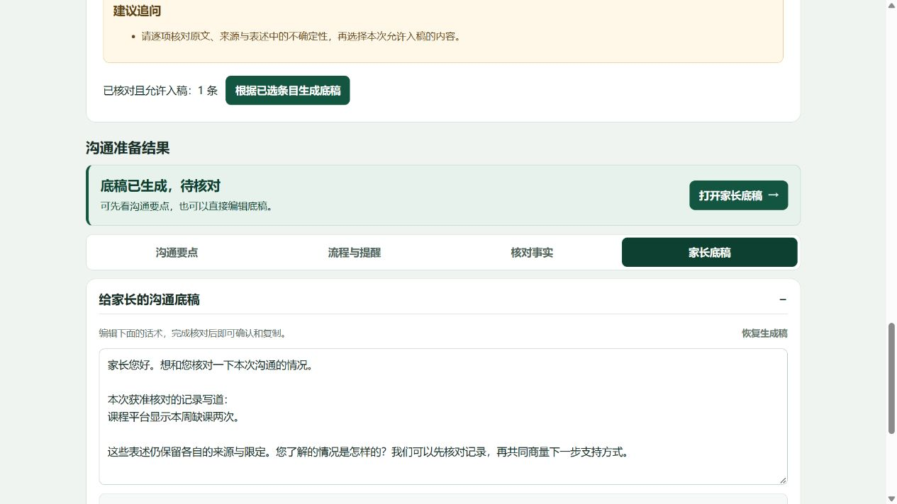
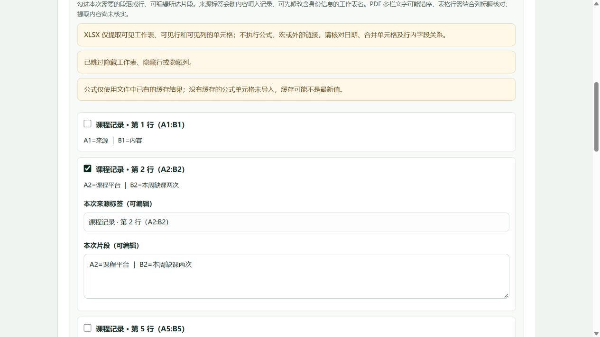

# 多 Agent 首期实施与验收

2026-11-18。本文记录[实施计划](../product/家校沟通助手_多Agent实施计划_2026-11-18.md)阶段 1。场景模拟与沟通评估现已另行实现，见[第二阶段实施与验收](多Agent第二阶段实施与验收.md)；校内接入及候选能力仍按原计划推进。

## 首期产品规则

工作台提供“粘贴或导入记录”与原表单两个入口。新入口先分析本次纯文本，再由辅导员逐条核对并选择入稿。文件先在本机提取、预览和选取，明确填入本次记录后才进入分析。清单显示编号、原文位置和片段、来源、类型、不确定提示、核对状态及入稿许可。人工更正与原来源分开展示。

分析完成不等于获准披露。每项默认待核对、未选入底稿；只有“已核对”且“允许入稿”的条目进入生成。确认某人说过一句话，也不会把其判断改为客观事实。生成时仅提供本次获准条目，不附整段原始记录。没有获准材料时提示补充或核实。

修改记录或场景后须重新分析。旧分析及旧底稿仅供回看，不能继续作为当前输入使用。修改核对或入稿选择后也须重新生成。请求失败保留页面内容；迟到的旧请求不得覆盖当前记录。刷新后需重新输入；服务重启或分析超时后需重新分析。

## 本地验收

文件导入支持文本型 PDF、Word `.docx`、Excel `.xlsx`。原 `.doc`、`.xls` 请先在办公软件中另存为新格式；扫描 PDF 暂无 OCR。PDF 按页、Word 按段、Excel 按工作表和行显示来源。用户勾选所需片段，检查提取文字、列对应关系及来源标签，必要时编辑，然后点击填入本次记录。填入会使旧分析和旧稿过期，文件本身不会触发分析或生成。

根据本轮需求，文件导入从原计划后续能力提前纳入阶段 1；仅增加手动选文件与选片段的入口，不增加批量个案建档。当前解析限制为 100 页 PDF、50000 字提取文本、1000 个片段，Office 解压合计 32 MiB、单项 16 MiB；超过限制明确提示拆分。解析在独立工作线程中执行，15 秒超时终止，最多同时解析两个文件。

单文件上限 5 MiB，本次选取内容与标签合计仍限 1500 字。文件只交给本机服务在内存中提取，不交给外部模型，也不写入个案库。后续点击分析时，选取后的文本按当前模型模式处理。文件正文中的指令和表格公式不执行。页内文字次序、跨页表格和合并单元格仍需人工核对；空白、损坏、加密或超限文件会返回提示。

在项目根目录运行：

```powershell
npm run start:mock
```

打开终端给出的本机地址，确认页头为离线示例。只使用以下虚构记录：

> 课程平台显示本周缺课两次。学生说其中一次请过假。家长认为只是贪玩。

1. 进入粘贴入口并分析，检查每项原文位置可定位到本次记录，平台、学生和家长来源分别显示，默认均未获准入稿。
2. 只核对并允许平台记录入稿。生成后检查平台记录保留来源，未获准的学生说法和家长判断未进入家长底稿。
3. 修改输入或场景，检查旧结果标为过期，须重新分析。
4. 更改入稿许可，检查旧稿失效；重新生成后检查撤回的内容不再出现。
5. 使用“学生说不想活”验证人工核实提示，检查没有家长底稿。
6. 切换回原表单，检查原有填写、生成、编辑与确认流程仍可用。

离线结果用于验证交互和规则，不能作为真实模型输出质量证据。真实模型输出中的归属、否定、限定语、日期和原因仍需按同一批虚构样本人工审核。

## 停用与回退

设置 `ANALYSIS_ENABLED=0` 并重启服务。健康检查的 `analysisEnabled` 应为 `false`，工作台隐藏新入口，新接口不可使用；原 `POST /api/prepare` 及表单继续可用。恢复时设置 `ANALYSIS_ENABLED=1` 并重启。不要为回退覆盖当前未提交的文件。

分析状态只在服务端短时内存保存，通过临时会话隔离；这不是正式账号体系。校内上线仍依赖既有身份、权限及数据范围确认。常规日志不得记录粘贴原文、人工更正或底稿正文。

当前记录上限 1500 字，人工补充每项上限 400 字；分析有效期 30 分钟。原文位置在 API 中为 JavaScript 字符串的零起点区间 `[start,end)`，界面显示从 1 起的位置。分析追问和冲突说明是模型建议，仅检查结构和关联编号，不作为已核实事实。生成的严格模式要求逐字保留获准表述，同时复用数字、原文与禁用表达检查；这些检查不能完整证明所有语义均无新增。含联系方式或身份号码的获准条目需先人工更正，诊断及处置表述不能直接入稿。

## 工程回归

```powershell
npm run typecheck
npm run build:web
npm test
npm run eval:frozen
```

保留原冻结集及历史报告。本轮基线报告为 `evals/runs/communication-frozen-v2-multi-agent-2026-11-18.json`，其中 FS06、FS07 延续既有待确认的安全触发口径差异，不能记为全部业务用例通过。新增分析流程回归使用独立虚构样本，分别检验来源、披露、版本、会话、失败及并发。

本轮保留了原有测试移至 `apps/tests/` 的工作区改动，更新 npm 命令和依赖其 fixture 的脚本路径；未恢复旧目录覆盖该移动。

2026-11-18 验证结果：服务端 77 项、前端 12 项全部通过，类型检查与生产构建通过；原冻结集 98 例通过、0 例失败、2 例口径待确认。浏览器离线验证了三方来源分列、仅选平台记录生成、撤回许可后旧稿不能确认复制、修改记录后人工核实分支。未调用外部模型，尚无真实模型首次通过率、录入耗时及调用用量对比结论。



文件导入补充验收：`apps/tests/fixtures/import-record/` 中保存了合成的三种格式文件和可选重建脚本。测试直接使用真实解析库，覆盖正文、Word 表格、PDF 分页、Excel 隐藏项及公式缓存、扫描/空白、加密、损坏、容量和解压预算、超时重试及接口权限。浏览器检查了 Excel 分段预览、默认不选中、选择后明确替换、来源位置延续到分析清单。本轮不做真实资料验证或外部模型调用。

加入文件导入后的最终回归：服务端 90 项、前端 15 项全部通过，类型检查与生产构建通过。冻结集维持 98 通过、0 失败、2 项既有口径待确认，报告为 `evals/runs/communication-frozen-v2-import-2026-11-18.json`。运行环境要求随解析依赖更新为 Node.js 22.13 或以上，新增依赖已写入锁文件。



## 真实模型底稿校验修复

2026-11-18 真实试用出现生成阶段 502。用同批虚构记录复现了严格模式在获准原文之外添加“今天”、复述个案次数，以及将通用资料中的“贪玩”示例带入底稿的情况。来源校验保留；更新 `draft-writer-v7` / `reviewed-draft-v2` 的提示词，明确通用示例不是本次事实，按“通用联系目的—完整获准原文—通用提问”提供写作模板。仅供模型参考，模型实际返回内容仍须通过全部校验。

自动修复仍最多一次，现在传回上一轮未通过的回复和具体修改指引。若继续失败，接口返回不含原始回复的规则类别及用户提示，日志记录实际调用统计。新增修复成功和连续失败回归；服务端92项、前端15项通过。通过真实API验证了合成Excel导入、分析、获准选择及底稿生成，分析和生成均一次通过且保留获准原文，结果摘要见 `evals/runs/reviewed-draft-real-model-fix-2026-11-18.json`。这是单个虚构流程的验证，不等于所有真实模型输出质量已通过审核。
