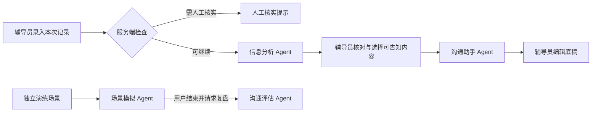

# 家校沟通助手多 Agent 实施计划

2026-11-18 · 讨论稿

## 目标与决策依据

先打通辅导员端的「粘贴记录 → 核对学生情况 → 准备家长沟通」流程。在此基础上扩展培训模拟和沟通复盘，逐步评估情绪支持、家长端和平台接入。辅导员负责核实信息、判断可告知范围，并审核最终底稿。

11 月 12 日组会提出优先推进信息分析，后续扩展场景模拟和评估。11 月 16 日会议进一步讨论了危机提醒、情绪支持、家长端和飞书接入。本计划提出的功能边界、接口和阶段顺序供项目组讨论。首期直接进入开发，以项目组内部的虚构场景回归验证，不依赖一轮新的辅导员上手试用。现有资料检索随沟通助手复用，知识库建设另行安排。

## Agent 职责与交接

| 能力 | 触发与输入 | 交付结果 | 使用边界 |
| --- | --- | --- | --- |
| 学生信息分析 Agent | 辅导员主动提交本次简短记录及场景 | 有原文出处的观察、记录和各方陈述，另列待核实项、说法冲突及建议追问 | 不从片段推断诊断、动机或事实真伪，不决定披露。复杂个体概念化框架留作后续专题 |
| 沟通助手 Agent | 辅导员核对、选择可入稿的内容后主动生成 | 沟通目标、要点、电话或消息底稿及可选回应 | 家长底稿依据本次确认的材料，辅导员自行修改和发送 |
| 场景模拟 Agent | 辅导员单独进入演练，选择虚构或经审核的改写案例 | 按场景设定扮演家长，进行多轮对话 | 使用演练专用上下文，保持人物设定和已知信息；用户可随时结束 |
| 沟通评估 Agent | 用户明确结束演练并请求复盘，传入演练记录和已审的评价标准 | 带对话依据的反馈、可替换的表达和下一项练习建议 | 先评估演练记录。真实沟通记录需单独确认使用条件，评分供学习反馈使用 |
| 情绪支持 Agent（候选） | 使用者主动选择沟通前后支持，提供自愿输入的情境 | 通用情绪整理、沟通准备或复盘提示 | 先确定服务对象和专业边界，再决定是否做成独立入口 |
| 家长端助手（候选） | 家长从独立入口主动咨询 | 日常亲子沟通建议、经审核的学校支持入口 | 独立身份和上下文。辅导员端个案信息如需流转，先定义权限、确认人和可用字段 |

危机提醒放在服务端流程里。首期沿用现有人工核实分支，在分析、生成入口使用同一规则，命中后显示人工核实提示。后续的触发口径、转介路径和联系方式由校方及心理发展中心确认后接入，避免用模型自由生成风险等级和转介决定。

## 首期功能与接口

1. **输入。** 在现有工作台增加「粘贴记录并梳理」入口，首期接收纯文本和场景。项目组开发和回归使用虚构记录。现有表单模式提供回退路径。
2. **分析。** 新增 `POST /api/analyze`（拟定）。以现有 `factCandidates` 的原文定位和来源标记为基础，模型补充条目归纳、冲突关联和缺项问题。服务端验证来源确实落在本次输入上，剔除无法定位的模型结论。本步返回分析标识、输入版本和待核对清单，尚未生成家长底稿。
3. **核对。** 条目至少包括编号、原文位置、原文片段、说话人或记录来源、类型、核对状态和可告知状态。类型区分记录、观察、当事人陈述和推测；核对与可告知分别由辅导员决定，条目默认待核对、未选入底稿。人工更正显示为人工补充，保留原来源。说法不一致时并列展示，保留各自归属和未核实状态。
4. **生成。** 新增 `POST /api/prepare-from-analysis`（拟定），接受当前分析标识、输入版本和辅导员复核后的选择。服务端核对标识归属、版本及条目状态，再组装本次沟通目标和可用条目，复用 `prepareCommunication` 的模型调用和结果校验。生成调用只接收获准的个案内容，不携带整段原始记录。若没有可用于个案底稿的材料，提示补充或核实。修改输入后，旧分析和旧底稿在界面中标过期。现有 `POST /api/prepare` 继续服务原表单。
5. **事实校验。** 先复用现有原文、数字和禁用表达校验，并为新流程补上「底稿关键事实对应获准条目」的约束。编号合法性和获准范围由服务端检查，事实类表达保留来源或不确定性。将擅自改写归属、添加日期或原因列为回归失败；只检查编号和数字不足以验证语义，因此需要对固定场景审核底稿内容。

示例：原文写「课程平台显示本周缺课两次。学生说其中一次请过假。家长认为只是贪玩」。清单把平台记录、学生陈述和家长判断分开，提示核对请假情况。即使辅导员确认家长确实说过这句话，「贪玩」也仍是家长判断。若只选择平台记录，底稿可写「课程平台上目前显示本周有两次未到课，我想先和您核对一下情况」。

## 技术方案与异常处理

- **部署与模型。** 沿用 React 工作台和 Node.js 服务，共用 `model-client.js` 和现有模型配置。分析、生成各自维护提示词、版本和结构化输出。后端按固定步骤调度，中间由辅导员显式确认。各能力可独立测试，首期在同一服务里运行。
- **编排。** 状态以「待分析、待核对、可生成、已生成、需人工核实」为主。服务端校验每一次操作的权限、前一阶段状态和版本；并发返回按当前输入版本处理，迟到结果不覆盖新记录。场景模拟与实际沟通准备使用独立会话。Agent 接收本阶段所需字段，材料中的命令式句子只作待分析文本。
- **失败与恢复。** 格式校验失败时，每阶段最多自动修复一次。网络或模型失败时保留当前记录和人工修改，支持单独重试失败步骤或回到原表单。使用配置开关关闭新入口和对应路由，重复提交合并为同一次在途操作。离线演示返回明确标注的示例。
- **临时状态与观测。** 本地原型建议用短时内存状态保存分析版本和核对信息，按当前会话隔离，超时或重启后重建。常规运行日志只记请求编号、阶段、结果、耗时、模型及提示词版本、调用次数和用量。校内接入前按现有方案确认数据范围、外部模型、账号权限及留存规定。
- **升级条件。** 模拟与评估有多轮状态且出现跨入口复用需求，再评估抽出公共会话层。只有在信息分析需要自主选择经授权的数据源或工具、继续追问等能力时，再增加受控工具调用，并单独定义权限、次数和终止条件。

## 分阶段推进

| 阶段 | 工作内容 | 可验收交付 | 依赖与顺序 |
| --- | --- | --- | --- |
| 1. 辅导员端首期 | 文本梳理、原文定位、人工核对与选择、生成底稿 | 可切换的新流程，已有表单可用，附冻结场景结果和回退说明 | 先明确字段和披露规则，再并行开发前端确认页与后端分析接口，最后联调 |
| 2. 模拟和复盘 | 选案例、扮演家长、多轮演练、依据评价项复盘 | 独立演练入口；每项反馈可定位到具体回合；可用案例和评分规则可审查 | 先定角色卡与评价标准，模拟跑通后接评估 |
| 3. 校内使用 | 根据需要评估飞书或校内入口，完善身份、权限、人工转介和操作留痕 | 目标环境能验证访问范围、停用和回滚 | 载体、数据范围、外部模型及人工路径由学校确认。平台调研可与阶段 2 并行 |
| 4. 后续能力专题 | 情绪支持、家长端、经批准的表格或聊天导入 | 分别明确首个场景、交互原型、数据范围和验收条件 | 情绪支持和家长端是否立项分别决定；文件导入按数据来源单独评估 |

## 验收与分工

首期复用已有冻结场景保住第一版行为，再补专门覆盖「同一段多方说法」「否定和不确定语气」「用户只允许披露部分内容」「输入已修改」「模型超时」「两次请求乱序」「安全分支」的虚构用例。对照用例中的事实、来源和允许披露清单。验收样本中，原文定位必须有效，禁止项不得出现在底稿，新旧输入不得串用。现有自动检查可验证接口、状态和分支；项目组逐条审核固定样本的归属、限定语和最终底稿。用同一批虚构样本对比原表单与新流程，记录录入耗时、需要重写的句子、首次通过率和两阶段调用用量，作为后续调整依据。

| 责任角色 | 首期任务 |
| --- | --- |
| 产品与辅导员业务代表 | 确认清单字段和核对动作，确定哪些信息可用于底稿，审核虚构样本输出 |
| 前端 | 实现粘贴、核对、选择、版本提示、错误保留及回退入口 |
| 后端与模型 | 实现分析接口、来源验证、确认状态、生成交接和功能开关 |
| 评测 | 准备基线和新增用例，验证事实归属、披露和异常恢复，记录差异 |
| 心理发展中心与校方平台负责人 | 在相应能力启用前确认专业口径、校内入口、授权与数据处理范围 |

首个开发交付用一个端到端的虚构案例跑通「分析 → 人工确认 → 生成」，随后补齐失败分支。项目组先确认两项产品决策：核对页需要显示的最小字段，以及哪些条目状态允许进入家长底稿。平台选型与后续 Agent 的细化可以在首期开发期间并行讨论。

参考：[11 月 12 日组会妙记](https://nankai.feishu.cn/minutes/obcn685873d8q521e8o4w55r?from=ai_minutes) · 《11 月 16 日会议纪要》 · [第一版项目说明](../../README.md) · [现有完整开发方案](家校沟通助手_完整开发方案_2026-11-11.md) · [场景评测](../../evals/README.md) · [校内试点审批与范围](../handoff/工作包5_校内试点审批与范围.md)
