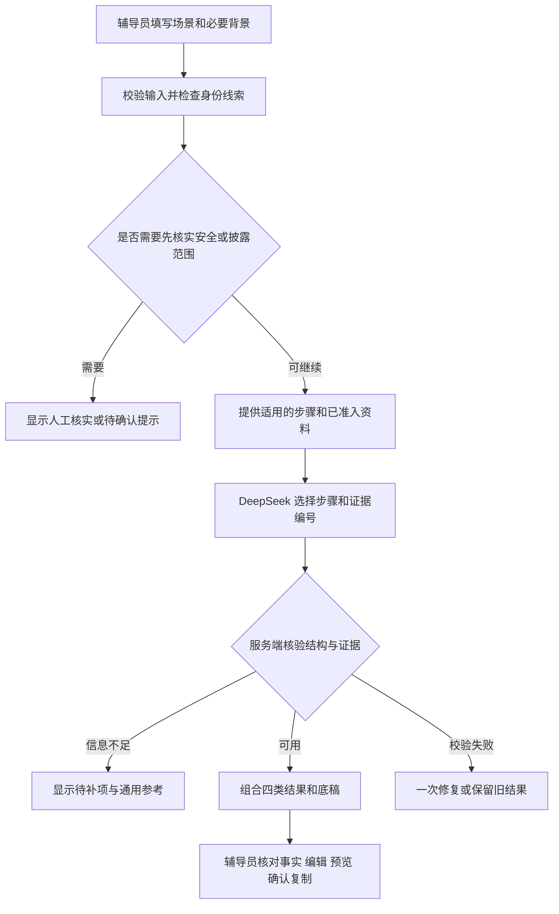

# 家校沟通助手完整开发方案

2026-11-11 · 从当前本地版本推进至辅导员演练验收、校内试点与持续维护。

依据 [原型交互设计文稿](原型交互设计文稿.pdf) 第 1–8 页、[辅导员验收问卷](../trial/验收标准_辅导员问卷.docx)、[开发进度](../development/progress.md) 和 [同题模型评测](../../evals/README.md)。本方案接续 11 月 10 日的初稿，以下各工作包的完成状态以代码、评测与校内验收记录为准。

## 1. 产品目标与交付范围

将现有原型发展成辅导员的单次沟通准备工作台。辅导员填写必要背景，在同一页面获得要点、流程参考、风险提醒和底稿，核对事实与资料、编辑并确认后自行复制到学校现有渠道。主要成效看准备耗时、底稿修改量、事实错漏和辅导员是否愿意使用。

首版覆盖学业警示与在校情况、心理健康首次告知与就医认知、一般家校沟通。家长不认可、明确拒绝、就医存疑或学生要求保密作为交叉条件。危机前期按原型以人工核实提醒为限，具体触发和演示入口依校内确认配置。

范围限定在辅导员端的本次准备。家长端、学生端、自由聊天、心理测评、诊疗建议、危机研判、个案档案、自动消息、平台接入和展览功能排除在本次交付范围之外。

| 交付层级 | 使用对象和数据 | 可以交付的能力 |
| --- | --- | --- |
| 可验收 MVP | 项目组、辅导员和中心评审，使用虚构或充分合成的场景 | 完成原型主流程、事实与出处核对、信息不足和转人工、可重复测试 |
| 校内试点 | 学校批准范围内的辅导员与场景，按确认的数据规则运行 | 受控访问、已审核流程、反馈与故障处理 |
| 持续维护 | 试点经验及经授权的资料 | 场景与资料更新、质量回归、版本升级与回滚 |

## 2. 当前基线与差距

| 当前已具备 | 下一步需要解决 |
| --- | --- |
| React + TypeScript 单工作台，桌面与窄屏布局、底稿编辑与确认状态、生成失败保留旧稿 | 对照原型完成首次说明、空态按钮、右侧详情抽屉、人工协助入口及键盘交互；旧结果标记后还需明确确认和复制权限 |
| 模型只选择步骤、输入和资料编号。服务端校验后拼装固定话术 | 原文能回看，尚缺逐项事实核对及允许披露范围。底稿个案细节靠手工填入 |
| 资料按场景、步骤和卡片版本匹配。现有 4 张通用卡为待核实，待审校内制度尚未参与生成 | 建立资料准入与变更审核，补足原始出处、适用条件和禁用范围 |
| 明确保密要求和安全关键词可提前分支。信息不足时提供通用准备 | DeepSeek 在只准备核对披露范围的 P05 样例中仍给出家长底稿。缺项识别与提醒触发须进一步验证 |
| 20 张虚构参考场景，已有千问和 DeepSeek 同题对照、本地回归与浏览器证据 | 已测样本较小，后续需要独立冻结集、辅导员盲评、中心侧确认及端到端回归 |

## 3. 模型与生成架构

主模型采用 DeepSeek Flash（`deepseek-flash`），按同题评测使用非思考模式与 JSON 输出。它在本项目的信息不足样例上能给出较具体的补充方向。P05 的不足由后续确定性披露分支解决。DeepSeek V4 Pro 和千问 Max 0902 用于显式质量对照，服务商切换由项目组配置。

常规请求用一次模型调用选择步骤和编号。结构校验不通过时可用错误字段修复一次。鉴权、限流、余额、超时和取消分别处理，结果区保留输入和上一次可用内容，显示本次失败。服务商不可用时提供重试和人工准备入口，禁止后台把同一输入发送给另一家服务商作为隐式回退。健康检查报告配置与运行模式，主动探测由单独预检命令触发。

继续采用模块化单体。保留 `apps/web/`、`app/` 和本机 Node HTTP 入口，按实际变化提取校验、事实、知识和模型模块。先用一份共享协议约束前后端，再考虑迁移目录、HTTP 框架或部署方式。保留 `POST /api/prepare` 与 `GET /api/health` 的入口；在响应里逐步明确正常、信息不足、披露待确认和人工核实四种结果状态，以及请求编号、输入版本、模型、提示词版本和资料版本。错误使用稳定代码，前端按状态渲染。

当前配置为 `AI_PROVIDER=deepseek`、`DEEPSEEK_MODEL=deepseek-flash`。服务端发送 DeepSeek 的非思考参数和 JSON 格式参数，JSON 内容再经项目协议校验。真实合成预检、本地生成路由测试、类型检查和构建已通过。[DeepSeek 思考配置](https://api-docs.deepseek.com/guides/thinking_mode/) · [JSON 输出](https://api-docs.deepseek.com/guides/json_mode/)

## 4. 事实、披露与资料支撑

1. **事实核对。** 在原文字段之上建立本次事实清单。每条保存编号、原文字段和片段、说话人或记录来源、时间、核对状态与可告知状态。原始输入仍可回看。模型建议的片段必须由服务端校验原文范围，保留“尚待核对”“学生自述”等限定；默认展示为待核实。冲突信息并列，例如平台显示未交与学生称已提交。辅导员决定哪些可以写入，系统不替其选择哪方属实。
2. **披露边界。** 心理首次告知、学生要求保密或明确表示只准备向学生核对时，工作台提供可告知范围的核对项。范围未知或明确暂不告知时，返回工作人员用的核对清单，暂停家长底稿。状态由辅导员确认，模型仅提示缺项。以 P05 为必测项，另测已确认范围、否定、引述与矛盾输入。人工核实仍由辅导员按校内流程完成。
3. **底稿组合。** 服务器按审核话术组织开场、事实、家长视角和后续沟通。只把人工选择的已核实且可告知的片段写入生成稿；推测、观察与未确认事项在核对区分别标记。对外句子能定位到原文或审核话术。修改事实或披露状态使旧底稿标记待复核，保留编辑内容；底稿文本变化撤销旧确认。
4. **资料准入。** 知识卡记录来源、原文定位、版本、适用场景、支持的步骤、审核状态、审核人、有效期和使用范围。分别记录可阅读、可引用、可发给外部模型、可用于训练。对过期、撤回或换版材料撤销旧引用；同一编号在其他场景或步骤仍须重新校验。通用方法不能充当个案事实或本校制度。校内依据缺失时给核对提示。
5. **先完善资料再扩大检索。** 先用版本化 JSON 和场景、角色、标签过滤。将学校确认的学业流程、职责、保密和人工协助口径做成小卡，再扩充通用方法。若检索召回不足，再评估全文检索或向量索引。记录每次改版的依据与被替换内容。

推荐书目可用于请教师制作审核卡。每卡提供适用情境、沟通原则、可用措辞、常见误用及出处页码。六本目录本身只作资料线索，书籍正文和使用许可另行确认。训练先列为后续可选项目。等事实、资料、提示词和模板趋于稳定，且同类质量错误持续出现，再用获准的教师修订样例比较微调收益。训练与独立评测按场景来源划分。

## 5. 对照原型的交付清单

| 编号 | 开发工作 | 通过条件 |
| --- | --- | --- |
| P0 使用边界 | 首次显示用途、辅导员责任、输入隐私及已确认的数据规则。常驻入口可回看 | 能点击“我已了解，开始使用”，边界与运行模式可辨认 |
| P1 工作台 | 保留桌面左右、窄屏上下布局。家长反应和学生意愿提供原型的单选预设，必要时附简短补充。空白禁用生成 | 切换场景保留输入且不生成；再生成前明确替换；旧结果仍可阅读并醒目标为过时 |
| P2 四类结果 | 先给重要要点、再展示流程、风险提醒与底稿。正常结果须有 3–5 条不同要点 | 四块同区可达；未选择阶段时展示五步参考，有选择时仅高亮该步；风险提醒描述沟通信号和核对动作 |
| P3 详情抽屉 | 从右侧展开，手机全屏或宽抽屉。显示目的、理由、一般化家长反应、参考回应、关联原文和资料出处 | 关闭后返回原阅读位置和焦点，键盘可进入和退出 |
| P4 底稿确认 | 同屏编辑，核对事实、推测、隐私与判断，支持还原、返回编辑、确认预览与复制 | 未确认、版本过时或人工分支不能复制。折叠、失败、取消保留修改，迟到结果不能覆盖 |
| P5 人工协助 | 遇到需要专业判断、披露待定或沟通卡住，给辅导员人工核实路径。可返回工作台。学校确认后配置具体入口 | 辅导员知道下一步找谁核实；界面不把提示当作已完成转介 |
| P6 后续事项 | 按场景展示可选的理解确认、再联系、核对学生意愿或人工协助 | 勾选是本次工作提示，刷新与关闭行为按确认规则执行 |
| E1 信息不足 | 识别缺触发事件、可核对观察、沟通目标或披露范围。给明确通用提示和补充入口 | 简短但完整的输入可生成；非空但不足时显示缺项及通用参考，补充后可重试 |
| E2 安全提醒 | 在可确定触发时进入校内人工核实。流程参考仅保留首步，底稿区换成人工提示 | 原型中的安全用语经中心确认；命中关键词只提示核实，危机稿、行动话术和复制均不可用 |

最先处理 P4 旧结果的使用风险。当前页面会标记输入已变化，但已确认的旧底稿仍可能显示复制按钮。补上输入、生成结果和草稿确认版本的关联，确保遇到新事实或安全信号时旧稿不能误复制。

## 6. 工作包与验收节点

工期按一名前后端开发可持续投入、辅导员和中心审核可配合估算。校内资料可并行准备；每包按出口条件收口。

| 顺序 | 工作包 | 交付与出口条件 | 预计开发时间 |
| --- | --- | --- | --- |
| 0 | 主模型接入 | DeepSeek Flash 成为默认，现有非思考评测配置接入正常生成路径。真实合成请求预检通过，应用路由用本地桩确认密钥、模型和参数 | 本轮 |
| 1 | 披露和确认状态 | 服务端披露暂停、E1 缺项、E2 人工分支、旧稿过时和复制约束。P05、M03、场景切换、取消和编辑后确认等用例纳入回归 | 3–5 个工作日 |
| 2 | 事实到可用底稿 | 事实清单、审核状态、逐项选择可告知事实、原文回溯。先完善三个常用场景和 10–20 张经审阅卡片 | 5–7 个工作日 |
| 3 | 原型交互收口 | 完成 P0–P6、E1/E2，补齐详情抽屉、人工协助、场景后续。完成桌面与手机键盘、取消、刷新、复制、失效的端到端测试 | 4–6 个工作日 |
| 4 | 演练与交付 | 冻结评测集，完成自动回归与人工评审。交付可运行版本、说明、证据与整改记录 | 3–5 个工作日，校内演练另约 |
| 5 | 有范围的校内试点 | 按学校确认的外部模型、日志与授权要求部署。选定试点人员、场景和维护人，完成访问控制与回滚演练 | MVP 验收及学校确认后排期 |

下一次开发按这个顺序执行。

1. 固化 P05 的披露暂停回归，先让服务端按结构化状态拦住底稿。
2. 在状态层绑定输入、生成结果与当前确认稿，关闭过时结果的确认和复制。
3. 把事实清单接到底稿编辑，先打通一例有冲突记录的学业沟通与一例披露范围明确的心理首次告知。
4. 用 DeepSeek Flash 重跑 20 张开发卡，记录缺项、事实保留、引用支撑和编辑成本。回归通过后再扩充话术。
5. 请辅导员和中心并行审核场景、话术、人工协助口径与资料授权。

## 7. 质量评测与交付标准

**工程回归。** 持续运行类型检查、构建和现有测试。补齐关键页面端到端测试，至少覆盖 1440×1000、390×844 与键盘操作。检查空白、简短有效输入、错误、重复提交、取消、过时结果、恢复原稿、确认后修改、无授权引用、关键请求字段和数据暴露。CI 默认使用本地桩；真实模型对照通过显式任务运行，保存可重现的版本和结果。

**模型和资料评测。** 先审阅 20 张开发场景，扩成 100 张独立冻结卡，建议按学业 30、心理首次告知 25、家长冲突 20、信息不足 15、安全提醒或越界诱导 10 分布。每例写清允许事实、必要缺项、可引用片段、预计分支和禁止输出。设置评审顺序，先看披露、事实和越权，再看步骤贴合、引用支撑与可用性。对照版本固定输入、资料和提示词，隐藏模型名，由辅导员分别评分。抽取易变样本重复运行，保存首次与修复后结果。

| 建议工程门槛 | 统计口径 |
| --- | --- |
| 冻结集内新增学生事实、伪造制度依据、重大越权、越界披露为 0 | 按完整结果和底稿逐项核对，记录用例数和失败证据 |
| 首次结构有效率 ≥99%，引用编号与版本有效率 100% | 仅在实际调用模型的用例上统计首次结构，人工分支单列 |
| 引用对建议的支撑率 ≥95% | 按人工核对的引用计数，审核文本是否真正支撑该步骤 |
| 人工暂停、信息不足与可生成分支有可复查结果 | 报告错拦与漏拦，明确触发限制，安全样例以校内确认口径复测 |
| 响应时延、底稿修改与任务耗时可度量 | 记录延迟 P50/P95、修复率、编辑处数与是否愿意采用；在试用时和人工准备过程对比 |

**辅导员和中心验收。** 2–3 位辅导员每人演练 2–3 次，有效演练不少于 6 次。沿用问卷的 C2、C4、C5、D3、F1、F2 六项否决规则，任一项 ≤2 分则整改后复测。通过需加权总分 ≥4.0 且各模块均分 ≥3.5。中心侧并行核对 S2、S3，两项均须超过 2 分，S1、S4、S5 均分 ≥3.5。危机提醒口径另经中心确认。最终交付包括功能清单、安装与运行方式、审核资料版本、测试和演练证据、未决问题、故障处理及回滚步骤。

## 8. 校内试点与后续方向

学校确定外部 API 与可处理数据范围后，按学校已有身份体系配置辅导员访问，限制试点范围；明确服务方与校方的保存期限、日志、刷新行为、问题报告和责任人。业务日志记录请求编号、状态、耗时、模型版本等运行指标，业务正文的采集另按确认规则。演练数据和审核资料分别管理。

试点版本与演示版本分开。更新模型、提示词、资料或学校流程时，先用冻结集和受影响场景回归，再发布到小范围试点。按版本可回滚模型配置、话术和卡片。发生异常时按记录定位到输入版本、模型、规则或资料版本，并把问题抽象成可复测的合成场景。

长期优先提升底稿可用性、资料可信度和不同院系的适配，结合每轮反馈扩充经审阅的话术和资料。若学校需要校内推理，则复用同一协议评测本地模型，并比较质量、部署和运维。模型升级或训练以独立评测改善为依据，继续用事实和权限校验控制输出。

## 9. 分工与校内确认

| 负责人建议 | 要确认或交付 | 影响 |
| --- | --- | --- |
| 项目开发 | 主模型、工作台、事实链路、评测、试用包和运行交接 | 工程可交付与回归 |
| 参与演练的辅导员 | 核对三类场景、披露边界、参考回应和底稿修改反馈 | 话术与实际可用性 |
| 中心或学校指定专业人员 | 学业警示与心理流程、五步名称和适用条件、E2 提示、人工协助入口和责任人 | P2、P5、E2 的校内版本 |
| 学校数据或平台负责人 | 外部模型、访问权限、数据与日志范围、保留期限、试点名单及退出机制 | 可用数据范围与部署 |
| 资料提供者与审核人 | 资料版本、原文定位、允许引用或处理的范围 | 资料上线与变更 |

并行优先收集三类材料。学校允许引用的流程与职责口径，3–5 个可公开演练的理想要点及反例，以及推荐书中可形成通用沟通卡的教师总结。校内资料尚未确认时，开发和演练可继续使用通用参考与虚构场景。[资料准备模板](../research/模型资料准备模板.md) · [待确认移交清单](../handoff/待确认移交清单.md)
